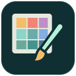

<p align="center">
  
</p>

<h1 align="center">PixelPainter</h1>

<p align="center">Turn PNG, JPEG and WebP images into Minecraft block art with perceptual color matching and persistent undo.</p>

<p align="center">
  
  
  
  <a href="LICENSE"></a>
</p>

<p align="center"><a href="#installation">Installation</a> · <a href="#compatibility">Compatibility</a> · <a href="#commands">Commands</a> · <a href="#configuration-and-upgrading">Configuration</a> · <a href="https://docs.despical.dev/pixel-painter/">Documentation</a> · <a href="https://javadoc.despical.dev/pixel-painter/">Javadocs</a> · <a href="https://github.com/Despical/PixelPainter/issues">Issues</a></p>

---

## Features

- PNG, JPEG and WebP sources painted as vertical walls or horizontal floor art in eight directions.
- 305 opaque block materials, Oklab perceptual color matching and optional Floyd-Steinberg dithering.
- Exact block-height sizing, aspect-ratio preservation and transparent-pixel handling.
- Tick-limited world edits with private progress, cancellation and bounded image workers.
- Durable undo journals, original block properties and restart/partial-operation recovery.
- Configurable MiniMessage panels, material filters and trusted HTTPS source downloads.

## Requirements

- **Java 25 or newer**, including when the server runs Minecraft 1.21.11.
- **Paper 1.21.11 through 26.3 inclusive.**
- Minecraft Java Edition clients that can join the server's protocol version.

## Compatibility

PixelPainter 2.0 compiles against the Paper 1.21.11 API and declares that minimum `api-version`. It uses current Paper APIs such as Adventure components, the plugin lifecycle and modern block data, so older servers cannot load it.

| Server software and version | Status |
| --- | --- |
| Paper 1.21.11 through 26.3 | Supported. Started and smoke-tested on Paper 1.21.11 and 26.3. |
| Paper 1.21.10 and earlier | Not supported. Use PixelPainter 1.x. |
| Spigot, CraftBukkit and Folia | Not supported. |
| Minecraft 1.8 through 1.12 | Not supported; these versions lack the block data the plugin relies on. |

Block materials that do not exist on the running server version are skipped, so the same `palette.yml` works across the supported range.

## Installation

1. Build with `./gradlew clean build` or `gradlew.bat clean build`.
2. Place `build/libs/pixel-painter-2.0.0.jar` in the server's `plugins` directory and restart.
3. Put PNG, JPEG or WebP files in `plugins/PixelPainter/images`, or use the download command with a trusted host configured in `config.yml`.

All permissions default to operators. Grant individual `pp.*` children to trusted builders as appropriate. World operations run with those administrative permissions; this plugin does not integrate with region protection or survival inventories.

## Quick start

```text
/pp list
/pp preview portrait.png 64 all true true
/pp create portrait.png north 64 true all true
/pp history
/pp undo
```

Stand at the desired **bottom-left block** of your image. Height is the exact number of block rows; width is calculated from the original aspect ratio. The example creates a 64-block-high wall, preserves transparent pixels, uses the complete palette and enables dithering. The estimate uses the same settings but never changes the world.

## Commands

`/pixelpainter` is an alias for `/pp`. Help and list panels support clickable commands, hover explanations and page navigation. All player-facing text lives in `messages.yml`, using Adventure MiniMessage and a consistent chat palette.

| Command | Permission | Purpose |
| --- | --- | --- |
| `/pp help [page]` | `pp.help` | Browse available commands |
| `/pp create <image> <direction> <height> [transparent] [palette] [dither]` | `pp.create` | Paint at your current block position |
| `/pp preview <image> <height> [palette] [dither] [transparent]` | `pp.howmanyblocks` | Estimate dimensions and material counts |
| `/pp undo [id or image]` | `pp.undo` | Restore the latest accessible painting or a specific journal |
| `/pp cancel` | `pp.cancel` | Stop preparation or your active world operation |
| `/pp list [page]` | `pp.list` | Browse source images |
| `/pp specs <image>` | `pp.specs` | Show source pixel dimensions |
| `/pp history [page]` | `pp.undo` | Browse accessible undo journals |
| `/pp materials [palette] [page]` | `pp.materials` | Browse supported blocks |
| `/pp download <image> <https-url>` | `pp.download` | Download and validate a source image |
| `/pp delete <image>` | `pp.delete` | Delete a source file, retaining placed art and undo |
| `/pp reload` | `pp.reload` | Validate and reload all configuration resources |

`/pp howmanyblocks` aliases `preview`; `/pp info` aliases `specs`. Creation, estimates, image inspection, downloads, deletion and history require an in-game player. Other reference commands and reload work from the console. An extension can be omitted if the image name is unambiguous.

If a painting would cross the world border, the error panel offers a **[Paint anyway]** button that confirms the request for a minute. Height limits can never be overridden.

Palettes: `all`, `concrete`, `wool`, `terracotta`. Optional defaults: `transparent=true`, `palette=all`, `dither=false`. Booleans must be `true` or `false`.

## Directions

The origin is the bottom-left corner; source images are read from top to bottom without vertical inversion. Horizontal directions describe the wall's outward facing normal.

| Direction | Image right | Image up |
| --- | --- | --- |
| `north` | East (+X) | Up (+Y) |
| `south` | West (-X) | Up (+Y) |
| `east` | South (+Z) | Up (+Y) |
| `west` | North (-Z) | Up (+Y) |
| `flat_northeast` | East (+X) | North (-Z) |
| `flat_southeast` | East (+X) | South (+Z) |
| `flat_northwest` | West (-X) | North (-Z) |
| `flat_southwest` | West (-X) | South (+Z) |

Old spellings such as `North`, `Up_North` and `FlatNorthEast` are accepted.

## Colors and new blocks

The bundled palette contains **305** numeric texture-average colors, including logs, wood/hyphae, stripped wood, ores, glazed terracotta, leaves, stable ice, mushrooms, cherry, bamboo, pale oak, resin, tuff, deepslate and waxed copper families. Glass is never used. Colors were generated from a local Minecraft 1.21.11 client JAR; no Minecraft textures are distributed. Unavailable materials are skipped on an older supported server.

Color matching uses **Oklab** perceptual distance. Optional **Floyd-Steinberg dithering** improves gradients with limited block palettes. Resizing preserves aspect ratio, enforces the configured block budget and retains alpha. Pixels below `images.alpha-threshold` are skipped when transparency is enabled; disabling transparency composites the image over `images.background`.

Extend `palette.yml` with a supported solid, non-gravity Bukkit material without block-entity state and a quoted sRGB hex value:

```yaml
blocks:
  PALE_OAK_PLANKS: '#E4DAD8'
  RESIN_BRICKS: '#CE5818'
```

Then run `/pp reload`. `palette.include` and `palette.exclude` filter the active palette. An invalid or empty palette rejects the reload, preserving previous settings. Some blocks have different top and side textures; the supplied color is a representative side sample. Leaves are placed with persistent block data to prevent natural decay. Foliage and translucent blocks vary with biome colors, light and background blocks; exclude those materials if you prefer opaque textures. Blocks that change on their own after placement (unwaxed copper, mycelium and nylium) and all glass are ignored even when listed, so paintings keep their colors and can always be restored.

